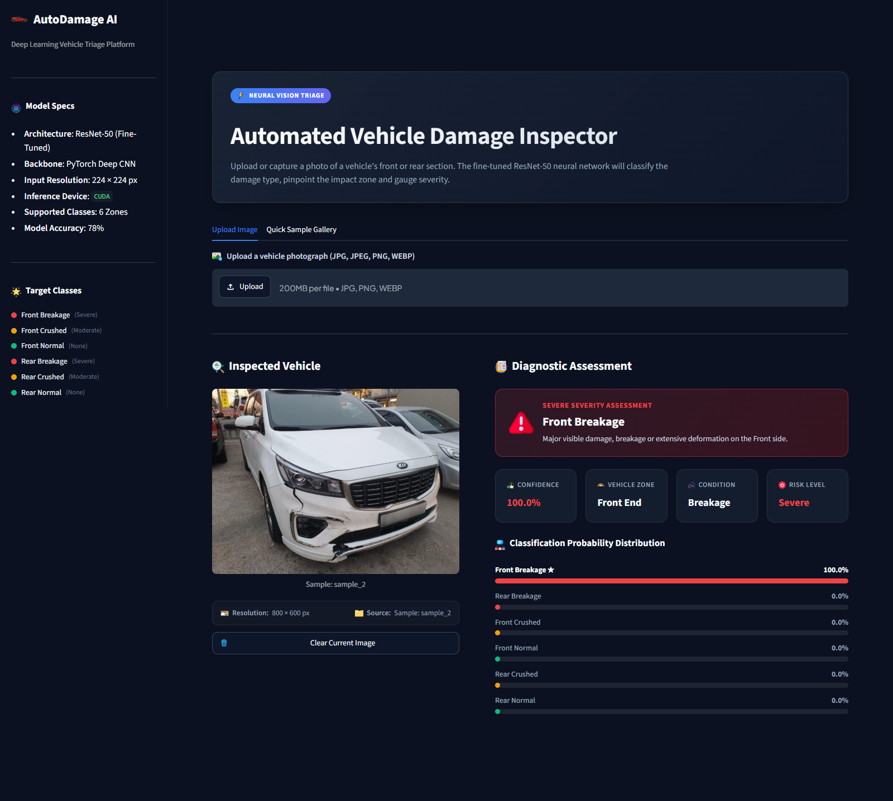
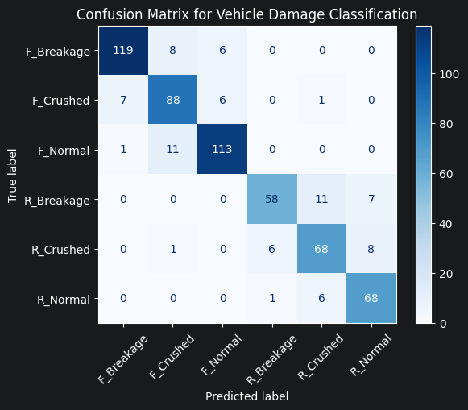
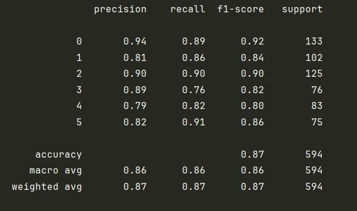

<div style="text-align: center;">

# AutoDamage AI: Automated Vehicle Damage Inspector

[](https://www.python.org/)
[](https://pytorch.org/)
[](https://streamlit.io/)
[](https://optuna.org/)
[](LICENSE)

</div>
<br/>

>  **Neural Vision Triage**  
> **Automated Vehicle Damage Inspector**  
> *Upload or capture a photo of a vehicle's front or rear section. The fine-tuned EfficientNet-V2-S deep neural network will classify the damage type, pinpoint the impact zone, and gauge severity in real-time.*

⚡ **Live Demo**: [https://autodamage-ai.streamlit.app/](https://autodamage-ai.streamlit.app/)

<br/>



</div>

---

## 📌 Table of Contents
- [ Overview](#-overview)
- [ Key Features](#-key-features)
- [ Target Classes & Damage Severity](#-target-classes--damage-severity)
- [ Model Architecture & Training](#-model-architecture--training)
- [ Model Performance & Evaluation](#-model-performance--evaluation)
- [📝 Changelog](#-changelog)
- [ Project Structure](#-project-structure)
- [ Installation & Setup](#-installation--setup)
- [ Usage Guide](#-usage-guide)
- [ API Deployment (FastAPI)](#-api-deployment-fastapi)
- [ Tech Stack](#-tech-stack)
- [📄 License](#-license)

---

##  Overview

**AutoDamage AI** is an intelligent computer vision application built to streamline vehicle inspection, insurance claim triage, and collision damage severity estimation. By leveraging a fine-tuned **EfficientNet-V2-S deep convolutional neural network**, the system processes external photographs of automobiles to instantly determine:

1.  **Impact Location**: Front End vs. Rear End
2.  **Damage Condition**: Normal (Intact), Crushed (Structural Deformation) or Breakage (Cracks/Fractures)
3.  **Severity Assessment**: None, Moderate, or Severe risk ratings
4.  **Softmax Probability Distribution**: Calibrated confidence scores across all candidate classes

The application provides a sleek, modern dark-mode dashboard built with **Streamlit** alongside a high-performance **FastAPI** microservice for automated pipeline integration.

---

##  Key Features


-  **Direct File Uploader**: Drag and drop `.jpg`, `.jpeg`, `.png`, and `.webp` vehicle photos with automatic format validation.
-  **1-Click Quick Sample Gallery**: Built-in test cases for all 6 damage categories allowing immediate inspection without searching for crash photos.
- **Instant Diagnostic Assessment**:
  - **Dynamic Severity Banners**: Color-coded badges with dedicated status icons ( None,  Moderate,  Severe).
  - **4-KPI Metric Grid**: Highlights  **Confidence %**,  **Vehicle Zone**,  **Condition**, and  **Risk Level**.
  -  **Probability Distribution Breakdown**: Sorted percentage meters displaying full softmax output with top prediction highlighting.
-  **Smart Image Management**: One-click **"Clear Current Image"** button that resets both session states and the underlying file uploader cache cleanly.
-  **Quick Reset & Cache Flush**: Dedicated sidebar button to clear app state and reload.
-  **Photography Best Practices Guide**: Integrated sidebar checklist for optimal camera angles, lighting, and framing.
- **Hardware Acceleration**: Automatic runtime detection of NVIDIA GPU (`CUDA`) with seamless fallback to `CPU`.
- **Automotive Glassmorphic UI**: High-contrast, responsive dark dashboard styled with custom CSS (`#0b1120` slate navy, glowing status indicators, and clean typography).
---

##  Target Classes & Damage Severity

The model classifies vehicle photos into 6 distinct categories:

| Target Class | Impact Zone | Damage Condition | Severity Rating | Description |
|:---|:---:|:---:|:---:|:---|
| `F_Breakage` | **Front End** | Breakage / Crack |  **Severe** | Cracks, fractures, broken headlights/grille, or split bumper at the vehicle's front. |
| `F_Crushed` | **Front End** | Crushed / Deformation |  **Moderate** | Heavy frontal impact with hood crumple, bumper collapse, or radiator intrusion. |
| `F_Normal` | **Front End** | No Damage Detected |  **None** | Intact front panels, hood, bumper, and headlights with zero structural damage. |
| `R_Breakage` | **Rear End** | Breakage / Crack |  **Severe** | Cracked taillights, fractured bumper cover, or rear windshield/tailgate glass fracture. |
| `R_Crushed` | **Rear End** | Crushed / Deformation |  **Moderate** | Severe rear-end impact with trunk intrusion, bumper displacement, or quarter-panel damage. |
| `R_Normal` | **Rear End** | No Damage Detected |  **None** | Intact rear bumper, trunk lid, and taillights without visible structural deformation. |

---

##  Model Architecture & Training

The core damage classification backbone is built upon **EfficientNet-V2-S**, offering high parameter efficiency, faster convergence, and superior feature extraction compared to earlier architectures:

```
Input Image (224 × 224 × 3)
         │
         ▼
EfficientNet-V2-S Feature Extractor (Earlier Stages Frozen)
         │
         ▼
Fine-Tuned Top Layers (features[-2:] Unfrozen)
         │
         ▼
Adaptive Average Pooling
         │
         ▼
Dropout Regularization Layer (p = 0.29)
         │
         ▼
Linear Classification Head (1280 ➔ 6 Classes)
         │
         ▼
Softmax Activation ➔ Calibrated Probabilities
```

### Key Architectural & Training Enhancements:
- **EfficientNet-V2-S Backbone**: Upgraded from ResNet-50. Freezing earlier feature stages retains generic visual representations while fine-tuning the final 2 backbone layers adapts the network to nuanced vehicular damage patterns.
- **Discriminative Learning Rates with AdamW**: Utilizes `AdamW` (`weight_decay=3.49e-6`) with differential learning rates:
  - **Backbone layers (`features[-2:]`)**: `4.6e-5` (slower learning rate to preserve representations)
  - **Classifier head**: `1.6e-4` (faster rate for rapid domain adaptation)
- **Dynamic Learning Rate Scheduling**: Employs `ReduceLROnPlateau(mode='min', patience=2, factor=0.2)` to scale down learning rates when validation loss reaches a plateau.
- **Comprehensive Data Augmentation**: Strengthened augmentation pipeline to counter variations in collision lighting, angle, and vehicle color:
  - `RandomHorizontalFlip(p=0.5)`
  - `RandomRotation(degrees=10)`
  - `ColorJitter(brightness=0.15, contrast=0.15, saturation=0.15, hue=0.03)`
  - `Resize((256, 256))` followed by `RandomResizedCrop(224, scale=(0.80, 1.0))`
  - Standard ImageNet channel-wise normalization
- **Targeted Dataset Expansion**: Integrated **73 newly annotated high-variance images** focusing on historically challenging and minority classes (`F_Crushed`, `R_Crushed`, and `F_Breakage`).

---

##  Model Performance & Evaluation

The upgraded EfficientNet-V2-S model achieved a remarkable **accuracy leap from 78% to 87%** on held-out evaluation datasets, displaying strong precision and recall across all damage locations and severity tiers.

<div style="text-align: center;">
  <table>
    <tr>
      <td style="text-align: center;"><b>Confusion Matrix</b></td>
    </tr>
    <tr>
      <td></td>
    </tr>
  </table>
</div>

### Detailed Evaluation Breakdown of Classification report (594 Test Samples):

<div style="text-align: center;">
  <table>
    <tr>
      <td style="text-align: center;"><b>Classification Report</b></td>
    </tr>
    <tr>
      <td></td>
    </tr>
  </table>
</div>

### Observations:
- **Major Accuracy Uplift**: Overall model accuracy increased by **+9 percentage points** (78% ➔ 87%).
- **Balanced Class Discrimination**: Both front and rear breakage/normal categories achieve ≥ 0.85 F1-scores, significantly reducing false negatives in severe impact conditions.
- **Deformation Disambiguation**: The additional training images drastically reduced confusion between crushed panels and simple surface breakages.

---

## 📝 Changelog

### [v2.1.0] - Modernized EfficientNet-V2-S & 87% Accuracy Milestone
- 🚀 **Fixed a bug in the Data augmentation and Pre-Processing.**
- ⚙️ **AdamW with Discriminative Learning Rates(Updated)**: Weight decay (`3.49e-6`) and differential learning rates:
  - Backbone layers: `8.16e-6`
  - Classifier head: `6.1e-4`
- ⚙️ **Stratified Train-Validation split introduced and Accuracy improvement from 86% to 87%.**

### [v2.0.0] - Modernized EfficientNet-V2-S & 86% Accuracy Milestone
- 🚀 **Backbone Architecture Upgrade**: Migrated from ResNet-50 to **EfficientNet-V2-S**, freezing all initial stages while fine-tuning only the last two feature layers (`features[-2:]`) and the dense classification head.
- ⚙️ **AdamW with Discriminative Learning Rates**: Switched optimizer from standard Adam to **AdamW** with weight decay (`3.5e-6`) and differential learning rates:
  - Backbone layers: `4.6e-5`
  - Classifier head: `1.6e-4`
- 📉 **Adaptive Learning Rate Scheduler**: Integrated `ReduceLROnPlateau` (`patience=2`, `factor=0.2`, `mode='min'`) to decay learning rate smoothly upon plateauing validation loss.
- 🔄 **Expanded Data Augmentation**: Introduced rotation (`±10°`), color jitter (brightness, contrast, saturation, hue), and `RandomResizedCrop` to improve invariance to lighting, reflections, and orientation.
- 📸 **Dataset Expansion (+73 Samples)**: Ingested 73 additional diverse, real-world crash and damage images specifically into `F_Crushed`, `R_Crushed`, and `F_Breakage`.
- 📊 **Empirical Performance Jump**: Validated **accuracy improvement from 78% to 86%** across 594 test images with a balanced **0.86 weighted F1-score**.

### [v1.0.0] - Initial ResNet-50 Baseline & 78% Accuracy Milestone
- Initial end-to-end pipeline using ResNet-50 transfer learning.
- 6-class damage and localization categorization with ~78% accuracy.
- Dataset of 2300 images with simple data augmentation.

---

##  Project Structure

```bash
Car_Damage_Detection_Project/
├── assets/
│   ├── app_demo.png                               # Diagnostic assessment UI preview
│   ├── confusion_matrix.png                       # Test set confusion matrix (87% accuracy)
│   ├── classification_report.png                  # Precision, recall, and F1 metrics
│   └── icons/                                     # Flaticon UI graphic assets
├── fastapi-server/                                # REST API backend microservice
│   ├── model/
│   │   └── EfficientNetV2S.pth                    # PyTorch weights for API server
│   ├── model_helper.py                            # Inference pipeline for FastAPI
│   ├── server.py                                  # FastAPI application routes
│   └── requirements.txt                           # API dependencies
├── streamlit-app/                                 # Interactive Streamlit Web Application
│   ├── .streamlit/
│   │   └── config.toml                            # Custom dark mode UI theme
│   ├── assets/
│   │   └── icons/                                 # Local Flaticon icon files
│   ├── model/
│   │   └── EfficientNetV2S.pth                    # Serialized model state dictionary
│   ├── notebooks/
│   │   ├── Auto_Damage_Transfer_learning_v3.ipynb # EfficientNet-V2-S training & evaluation pipeline(Updated)
│   │   ├── Auto_Damage_Transfer_learning_v2.ipynb # EfficientNet-V2-S training & evaluation pipeline
│   │   ├── Auto_Damage_Transfer_learning_v1.ipynb # Baseline exploratory & training notebook
│   │   ├── Optuna_study-Effiecient_net_V2_S_updated.ipynb # Bayesian hyperparameter optimization new study
│   │   ├── Optuna_study-Effiecient_net_V2_S.ipynb # Bayesian hyperparameter optimization
│   │   ├── Optuna_study_ConvNeXt.ipynb            # ConvNeXt hyperparameter optimization
│   │   └── Optuna_study_Resnet50.ipynb            # Resnet50 hyperparameter optimization
│   ├── samples/                                   # Pre-packaged demo images for 1-click testing
│   ├── app.py                                     # Main Streamlit dashboard application
│   ├── model_helper.py                            # Model architecture, transforms & inference logic
│   └── requirements.txt                           # Streamlit app dependencies           
└── README.md                                      # Root project documentation
```

---

##  Installation & Setup

### 1. Prerequisites
- **Python**: Version `3.10` or higher
- **GPU (Optional, Recommended)**: NVIDIA GPU with CUDA drivers installed for hardware-accelerated inference

### 2. Clone the Repository
```bash
git clone https://github.com/<your-username>/Car_Damage_Detection_Project.git
cd Car_Damage_Detection_Project
```

### 3. Create and Activate Virtual Environment
```bash
# Windows (PowerShell)
python -m venv .venv
.\.venv\Scripts\Activate.ps1

# Linux / macOS
python3 -m venv .venv
source .venv/bin/activate
```

### 4. Install Dependencies
```bash
cd streamlit-app
pip install -r requirements.txt
```

---

##  Usage Guide

### Launching the Streamlit Web Application

From within the `streamlit-app` directory:
```bash
streamlit run app.py
```

Once started, open your web browser and navigate to:
```
http://localhost:8501
```

### How to Inspect a Vehicle:
1. **Upload an Image**: Go to the **Upload Image** tab and upload a JPG, JPEG, or PNG photo of the vehicle's front or rear.
2. **Or Test with Samples**: Go to the **Quick Sample Gallery** tab and click any thumbnail to test instantly.
3. **View AI Diagnostics**:
   - Inspect the **Severity Banner** and **4-KPI Grid** for primary findings.
   - Review the **Probability Distribution** to observe confidence spread across classes.
4. **Clear or Switch**: Click **Clear Current Image** to reset the inspector or upload a new photo.

---

##  API Deployment (FastAPI)

For headless or service-to-service deployments, a lightweight FastAPI microservice is included:

```bash
cd fastapi-server
pip install -r requirements.txt
fastapi dev server.py
```

- **Interactive API Docs (Swagger UI)**: `http://localhost:8000/docs`
- **Inference Endpoint**: `POST /predict/` accepts multipart image file uploads and returns predicted damage class and diagnostic payloads.

---

##  Tech Stack

- **Computer Vision & Deep Learning**: [PyTorch](https://pytorch.org/), [Torchvision](https://pytorch.org/vision/), [Pillow](https://pillow.readthedocs.io/)
- **Architecture**: [EfficientNet-V2-S](https://pytorch.org/vision/main/models/generated/torchvision.models.efficientnet_v2_s.html)
- **Hyperparameter Optimization**: [Optuna](https://optuna.org/)
- **Frontend / Dashboard**: [Streamlit](https://streamlit.io/) with custom modern CSS & HTML5
- **Backend API**: [FastAPI](https://fastapi.tiangolo.com/), [Uvicorn](https://www.uvicorn.org/)
- **Data & Scientific Computing**: [NumPy](https://numpy.org/), [scikit-learn](https://scikit-learn.org/)

---

## 📄 License

This project is licensed under the [MIT License](LICENSE). You are free to use, modify, and distribute it for academic, personal, and commercial applications.
